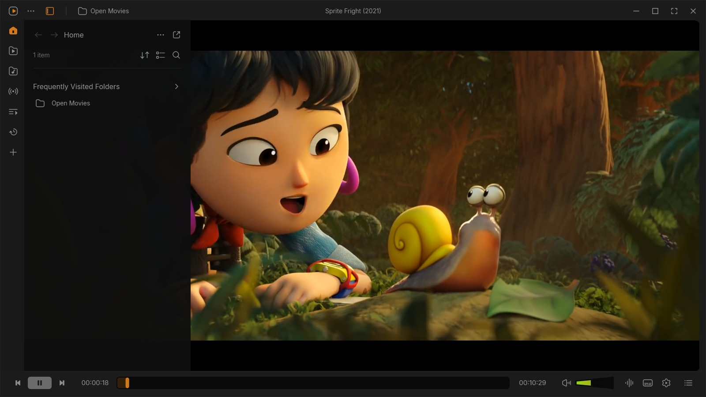
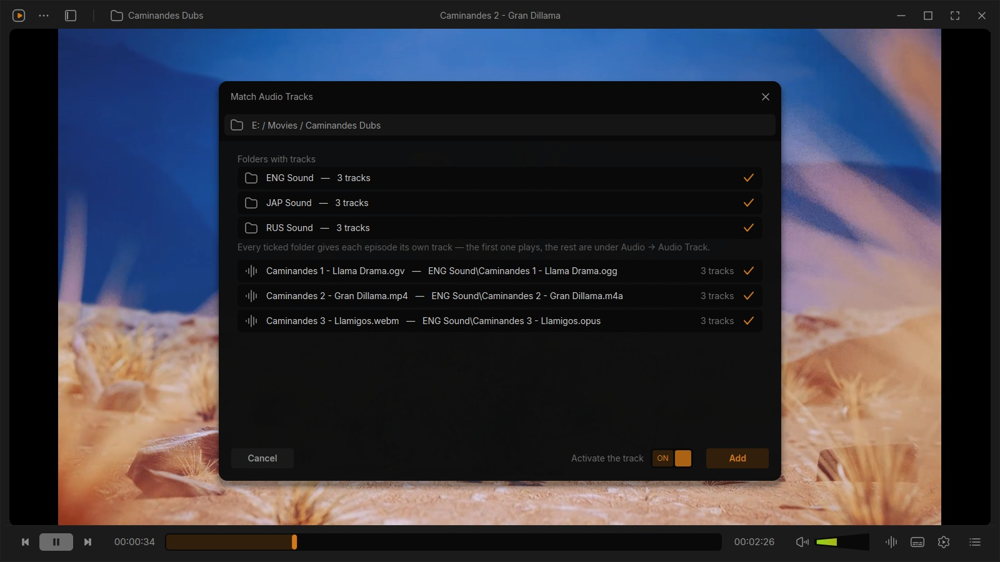
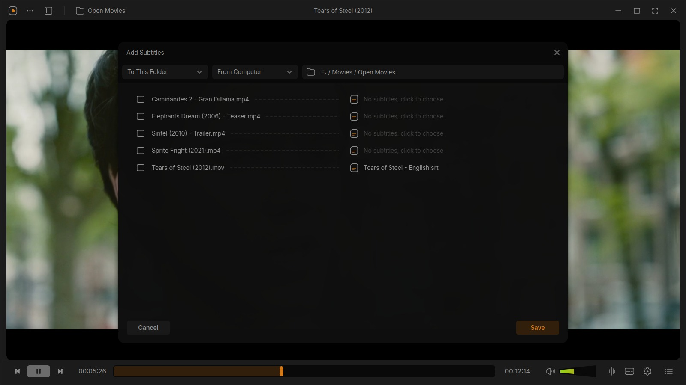
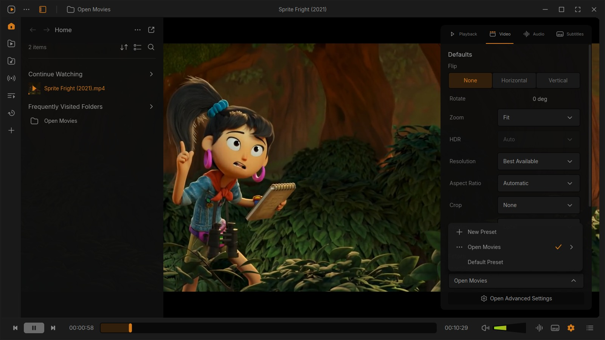
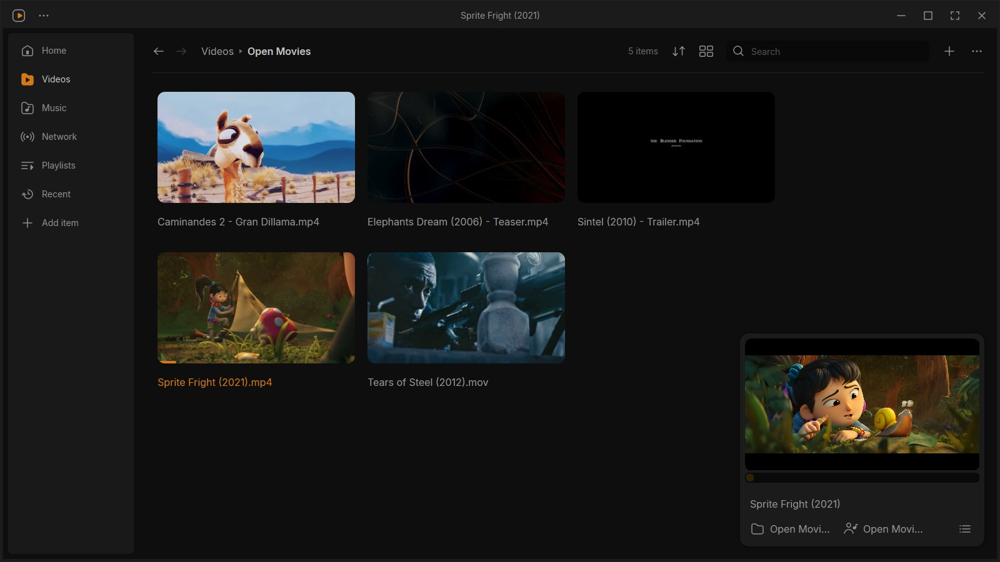

# Konus

**English** | [Русский](README.ru.md)

Konus is a video player for Windows that keeps the film in front. One slim bar of controls, panels that slide in
when you want them, and a library that can sit beside the video instead of over it. Playback is libVLC — the
engine inside VLC media player — so it opens what your VLC opens, and your VLC itself stays exactly as it is.

The interface is Juxtopposed's [VLC Redesign](https://youtu.be/ERFeOgqk324) brought to life: her
[Figma file](https://www.figma.com/community/file/1691465999134370980) drawn as a working player. The parts a
design can't show are the ones that matter after the first week of use, and those are what Konus adds — starting
with the season drawer below.

## Install

Both files are on [the releases page](https://github.com/Prazzity/Konus/releases); take whichever suits you. Neither
Python nor VLC has to be on the machine.

**The installer** — `Konus-<version>-setup.exe`. Double-click it and you're done: about 60 MB, no administrator,
nothing written outside your own user folder. It adds a Konus entry to the Start Menu and, if you like, a shortcut
on the desktop. To remove it, use Settings → Apps → Konus — the uninstaller asks whether to delete your settings
and library too.

**The portable one** — `Konus-<version>-portable.zip`, about 60 MB. Unzip it anywhere — a USB stick, your
Downloads folder, a folder on a work laptop — and run `Konus-portable.exe` from inside. It needs nothing installed
and writes nothing outside its own folder: settings, library, playlists, watch positions and the cache all live in
`data\` next to the program, so the folder travels with you exactly as it is, and copying it to another machine
brings your library along. Deleting the folder removes every trace. Nothing is unpacked at every start, so the
player comes up as fast as the installed one.

Both are unsigned, so SmartScreen may warn once — *More info* → *Run anyway*. Windows 10 or 11, 64-bit.

## Watching a series

Anime and series rips are work. The audio often isn't inside the video files — it comes as a separate folder of
tracks next to the episodes, one per episode. The subtitles are loose `.srt` files whose names don't quite match
the episodes they belong to. And every episode needs the same picture and sound settings picked all over again.

**Match tracks to the folder.** Sound → *Match tracks to the folder…* reads the folder — and its subfolders,
however deep the release buries them — and pairs each episode with its own audio track by episode number and name.
The folders the tracks were found in are listed at the top, each with its track count, and the ticks say which of
them to take tracks from: tick one dub folder and every episode gets that dub, tick all of them and every episode
gets all of them. Each row shows the track that episode plays and, beside it, how many tracks were matched to it —
a release that ships three dubs for the season leaves three on every episode, and *Sound → Audio Track* switches
between them while it plays, without losing the place. The *Activate the track* switch beside Add (on by default)
gives the matched tracks to the episode that is playing right now; the rest pick theirs up when they start, as does
an episode you copy into that folder later.

**Add subtitles to a folder.** The same trick for subtitles: point it at a season's worth of `.srt` files and it
pairs them with the episodes by number and name, in one pass. Correct any row you don't agree with before saving.

**Save the settings as a preset.** Set the first episode up the way you like it — brightness, subtitle size, audio
track, whatever the show needs — press *New Preset* in the settings panel, name it after the show, and Konus uses
those settings for that folder, for every episode in it. The rest of your library is untouched.

## What it can do

**Watching.** The seek bar is thick enough to hit and shows a preview frame when you hover it; click the time to
jump somewhere, click the duration to see how much is left. Volume goes to 200%. In fullscreen the bars stay out
of the way until you move the mouse to the top or bottom edge (`Ctrl+\` does the same in a window). Picture in
picture, snapshots and recording a clip are one click away.

**The library.** It opens as a panel beside the video or as a full window with a small player in the corner:
videos, music (songs, albums, artists, genres), network streams, m3u lists, podcasts, radio, playlists, favourites
and recently played. Watched items grey out, and *Continue Watching* remembers where you stopped, down to the
second.

**Sound and subtitles.** Track pickers that say what the tracks actually are, a choice of speakers or headphones,
subtitle sync with the timeline right on the seek bar, and font, size and colour for text subtitles.

**Your player.** Light and dark theme with nine accent colours, keyboard shortcuts you can change (global ones
too — they fire while another program has the focus), profiles for different kinds of watching, and *Customize
Player*, where you drag the buttons into the order you want.

**Also.** Convert and Stream, chapters and bookmarks, a library that survives a rename, and an interface in
English or Russian — asked on the first start, so the very first window is already in your language, and switched
from Settings afterwards without a restart: the interface is rebuilt in place and the film keeps playing.

## Good to know

- Settings live in `%APPDATA%\konus`, the cache in `%LOCALAPPDATA%\konus`. Nothing is written next to the program.
- Installing a newer build over an older one keeps everything: the library, the profiles and the layout come with
  you.
- ffmpeg in `PATH` (`winget install ffmpeg`) adds the seek-bar preview frames and the waveforms; everything else
  works without it.
- Changing a filter (flip, sepia, the compressor) makes the picture blink for a second, because libVLC 3 restarts
  playback at the same spot to change it.
- Styled `.ass` subtitles (most anime) keep their own look until you change font, size or colour — after that
  they're drawn as plain text in your style. Subtitles from DVD and Blu-ray rips are pictures and can't be
  restyled at all.
- Reverse playback, HDR tone mapping and casting aren't possible with libVLC 3, so those options are greyed out.
- Subtitle search opens the OpenSubtitles website, since their API needs a key of your own.

## Licence and credits

The project's own code is **MIT**; the build as a whole is **GPLv3**, since it stands on PyQt5 and mutagen (GPL)
and on libVLC and python-vlc (LGPL). The design and icons are *"VLC Redesign" by Juxtopposed*
([CC BY 4.0](https://creativecommons.org/licenses/by/4.0/)), the films in the screenshots are Blender Studio's
open movies (CC BY), and the interface font is [Inter](https://github.com/rsms/inter) (OFL).

VLC, VideoLAN and the cone are VideoLAN's marks; Konus uses none of them and is not affiliated with VideoLAN. It
just plays through libVLC, which is what VideoLAN publishes the engine for.

## For developers

### Build the release files

    .venv\Scripts\python.exe tools\build_installer.py

This makes all three, and puts the two files a release needs in `dist\release\`:

1. `packaging\konus.spec` → `dist\Konus`: `Konus.exe` with PyQt5, the assets and the libVLC runtime inside. It
   needs `runtime\libvlc`, so run `python fetch_libvlc.py` once first (or `--from "C:\Program Files\VideoLAN\VLC"`
   to copy an installed VLC instead of downloading).
2. `packaging\konus-portable.spec` → `dist\Konus-portable`, the portable folder: `Konus-portable.exe` with the
   licence texts and the python-vlc binding carried inside it, and a `data` folder beside it for everything the
   player writes. It is zipped into `dist\release\Konus-<version>-portable.zip` and the folder inside the zip
   carries the version, so an unzipped build next to an older one reads as what it is.
3. `packaging\konus.iss` (Inno Setup) → `dist\release\Konus-<version>-setup.exe`. The installer packs the folder
   build, and that one keeps its settings where it always did, in `%APPDATA%\konus` — only the portable build
   lives out of its own folder (see `konus\portable.py`).

Both tools have to be installed: `pip install pyinstaller` and `winget install JRSoftware.InnoSetup`. What goes
into a bundle and what is left out is decided once, in `packaging\konus_common.py`. The version comes from
`konus\__init__.py` and reaches the About box, both executables' file properties and the installer's name from
there. `--without-portable`, `--without-installer` and `--installer-only` cut the run down to one part.

`KONUS_DATA_DIR` in the environment sends any run's settings and cache to the folder it names instead, which is
how the screenshot tool and anything else that starts the app keep out of your own settings. A run that starts
with its own data folder also gets its own single-window slot, so it can sit next to a player that is already
open instead of handing its files to it.

`KONUS_STARTUP_LOG=<file>` writes down how long a start takes — the data folder, the settings, libVLC, the first
painted frame, and whether libVLC was given a usable plugin list — and with `KONUS_STARTUP_EXIT` the app closes
right after that frame, which is what a benchmark loop wants. Both are for measuring a "the window takes forever
to appear" report, not for normal use.

The README screenshots come from `tools/make_screenshots.py`, which runs the app for real and photographs its
window; `--media` points at a folder of openly licensed films to show.

### Run it from a folder (with Python)

1. Install [64-bit Python 3.10 or newer](https://www.python.org/downloads/windows/) and tick *Add python.exe to
   PATH* while doing it.
2. Double-click `setup.bat` once. It makes a private `.venv`, installs PyQt5 and mutagen, and offers to fetch the
   libVLC runtime (about 80 MB, around 140 MB unpacked into `runtime\libvlc`) so VLC doesn't have to be installed.
3. Start it with `run.bat`, or with the shortcut `setup.bat` can put on your desktop. `run.bat` keeps a console
   open, which is handy when something goes wrong; the shortcut doesn't.

### The libVLC runtime

The runtime is a folder like any other and the app prefers it over anything installed. `python fetch_libvlc.py`
fetches it by hand — `--version` for another release, `--force` to replace what is there, `--lgpl-only` to leave
out the modules that are GPLv2+, `--cache-only` to rebuild the plugin cache — and deleting `runtime\libvlc` puts
the app back on your installed VLC. A
`VLC_DIR` environment variable overrides all of it. In an installed build the runtime sits in
`_internal\runtime\libvlc`, and a `runtime\libvlc` folder next to `Konus.exe` is looked at first, so a runtime you
drop in works there too.

### Updating, uninstalling

An installed build is updated by running the newer installer over it; a portable one by unzipping the newer build
and copying `data\` across, or simply by replacing the old folder and keeping the newer one's `data\`. From a
folder, copy the new version over it (or `git pull`) and leave `runtime\libvlc` and
`.venv` where they are — if `requirements.txt` changed, `setup.bat` installs the difference in a few seconds.

Uninstalling keeps your settings, library and playlists in `%APPDATA%\konus` (the cache in `%LOCALAPPDATA%\konus`)
unless you tell the uninstaller to delete them; delete those two folders by hand and nothing is left. A portable
build has nothing to uninstall: its `data` folder is the whole of it, and deleting the folder is the whole of
deleting it.
