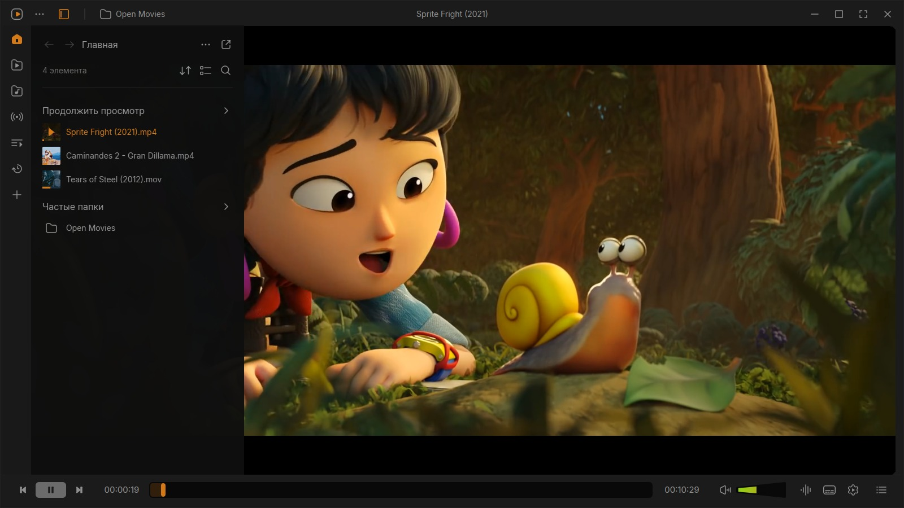
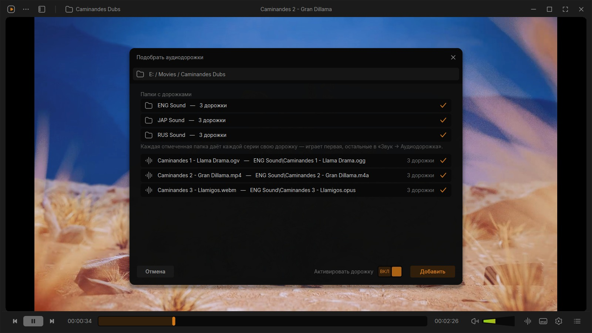
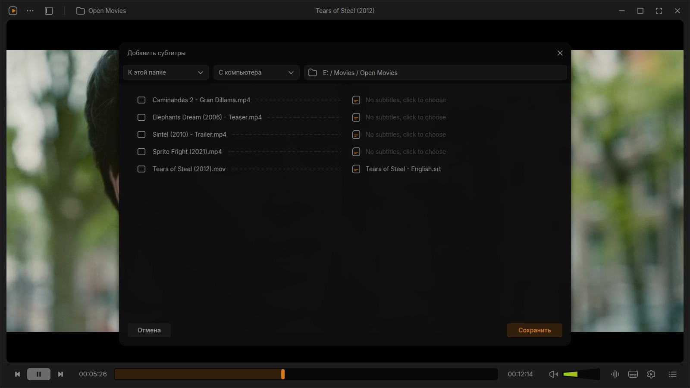
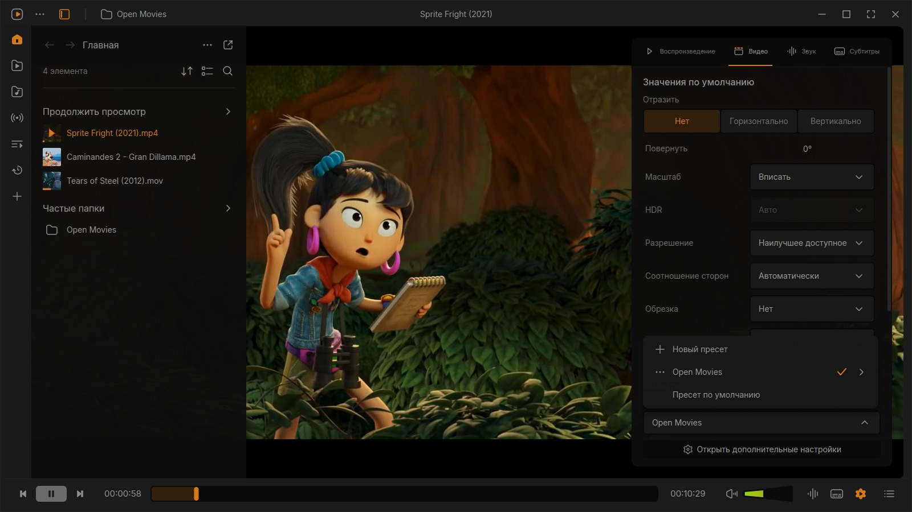
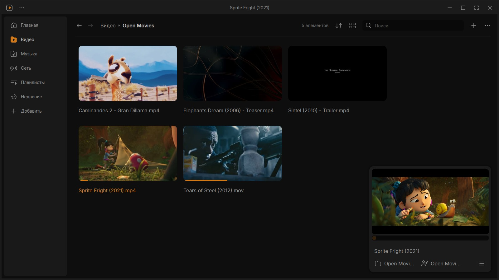

# Konus

[English](README.md) | **Русский**

Konus — видеоплеер для Windows, который не мешает смотреть кино. Одна невысокая панель управления, панели,
которые выезжают, когда нужны, и библиотека, которая может стоять рядом с видео, а не закрывать его. Играет
через libVLC — тот самый движок, на котором работает VLC, — так что открывает всё то же, что открывает ваш VLC. А
сам VLC остаётся нетронутым.

Интерфейс взят из [редизайна VLC](https://youtu.be/ERFeOgqk324) от Juxtopposed: её
[макет в Figma](https://www.figma.com/community/file/1691465999134370980) здесь ожил и стал плеером. А то, чего в
макете не нарисовать, — это всё, что нужно уже через неделю использования. Об этом ниже, и начинается всё с
сериалов.

## Установка

Оба файла лежат на [странице релизов](https://github.com/Prazzity/Konus/releases) — берите тот, что удобнее. Ни
Python, ни VLC ставить не нужно: всё внутри.

**Установщик** — `Konus-<version>-setup.exe`. Двойной щелчок, и готово: около 60 МБ, права администратора не
нужны, за пределы вашей папки пользователя ничего не пишется. Добавляет Konus в меню «Пуск» и, если захотите,
ярлык на рабочем столе. Удаляется через «Параметры → Приложения → Konus» — удалятор заодно спросит, стирать ли
настройки и библиотеку.

**Одиночный файл** — `Konus-<version>-portable.exe`. Тот же плеер в одном файле на 95 МБ: можно положить на
флешку, в «Загрузки», да куда угодно, и запускать двойным щелчком. При каждом запуске он распаковывается во
временную папку и убирает её, когда окно закрывается, — поэтому первое окно появляется на несколько секунд позже.
Удалили файл — от плеера ничего не осталось.

Оба файла без цифровой подписи, так что SmartScreen может один раз предупредить: *Подробнее* → *Выполнить в любом
случае*. Нужна 64-битная Windows 10 или 11.

## Сериалы: дорожки, субтитры, настройки

Аниме и сериальные рипы — та ещё морока. Звук обычно лежит не в самом видео, а рядом, в папке вроде «RUS Sound»,
по дорожке на серию. Субтитры — отдельные `.srt` с именами, которые с сериями толком не совпадают. А картинку и
звук приходится настраивать заново в каждой серии.

**Подобрать дорожки к сериям.** Пункт «Звук → Подобрать дорожки к сериям…» разбирает всю папку, находит для
каждой серии её собственную дорожку — по номеру эпизода и названию — показывает, что получилось, и запоминает
пары. Дальше каждая серия играет со своей дорожкой, а серия, скопированная в папку позже, подхватывается сразу
при запуске. Дорожки могут лежать и рядом с сериями, и в подпапке — обычно они всё-таки в подпапке.

**Добавить субтитры к папке.** То же самое для субтитров: указываете папку, где лежит `.srt` на целый сезон, — и
он разбирает их по сериям за один проход. Любую пару можно поправить, прежде чем сохранять.

**Сохранить настройки пресетом.** Настройте первую серию под себя — яркость, размер субтитров, дорожку, что
угодно, — нажмите в панели настроек «Новый пресет» и назовите его по имени сериала. Konus запомнит эти настройки
для папки и вернёт их в каждой серии. Остальные папки это не затронет.

## Что он умеет

**Смотреть.** Полоса перемотки достаточно толстая, чтобы по ней попадать, а при наведении показывает кадр
предпросмотра. Щёлкните по времени — перейдёте куда нужно, щёлкните по длительности — увидите, сколько осталось.
Громкость — до 200%. В полноэкранном режиме панели прячутся, пока не подведёте мышь к верхнему или нижнему краю
(`Ctrl+\` делает то же самое в окне). Картинка в картинке, снимки и запись фрагмента — в один щелчок.

**Библиотека.** Открывается панелью рядом с видео или отдельным окном, где в углу играет маленький плеер: видео,
музыка (песни, альбомы, исполнители, жанры), сетевые потоки, списки m3u, подкасты, радио, плейлисты, избранное и
недавно проигранное. Просмотренное становится серым, а «Продолжить просмотр» помнит, где вы остановились, — с
точностью до секунды.

**Звук и субтитры.** Выбор дорожек, где видно, что это за дорожки на самом деле; выбор колонок или наушников;
синхронизация субтитров прямо на полосе перемотки; шрифт, размер и цвет для текстовых субтитров.

**Плеер под себя.** Светлая и тёмная темы, девять акцентных цветов, горячие клавиши, которые можно переназначить
(в том числе глобальные — они срабатывают, даже когда активна другая программа), профили под разные виды
просмотра и «Настроить плеер», где кнопки перетаскиваются в нужном порядке.

**Ещё.** «Конвертировать» и «Трансляция», главы и закладки, библиотека, которая переживает переименование, и
интерфейс на русском или английском — язык спрашивается при первом запуске, так что первое же окно открывается
на нужном, а дальше он меняется в настройках без перезапуска: интерфейс перестраивается на месте, фильм
продолжает играть.

## Что стоит знать

- Настройки лежат в `%APPDATA%\konus`, кэш — в `%LOCALAPPDATA%\konus`. Рядом с самой программой не пишется
  ничего.
- Новая версия ставится поверх старой и всё сохраняет: библиотека, профили и раскладка остаются на месте.
- ffmpeg в `PATH` (`winget install ffmpeg`) добавит кадры предпросмотра на полосе перемотки и осциллограммы. Без
  него работает всё остальное.
- При смене фильтра — переворота, сепии, компрессора — картинка на секунду мигнёт: libVLC 3 перезапускает
  воспроизведение на том же месте, чтобы его сменить.
- Оформленные `.ass`-субтитры (большая часть аниме) сохраняют свой вид, пока вы не тронете шрифт, размер или цвет.
  После этого они рисуются обычным текстом в вашем стиле. Субтитры с DVD и Blu-ray — картинки, их не переоформить.
- Обратное воспроизведение, tone mapping HDR и кастинг в libVLC 3 невозможны, поэтому эти пункты неактивны.
- Поиск субтитров открывает сайт OpenSubtitles: их API требует собственный ключ.

## Лицензия и благодарности

Код проекта — **MIT**, сборка целиком — под **GPLv3**: внутри PyQt5 и mutagen (GPL), а также libVLC и python-vlc
(LGPL). Дизайн и иконки — *«VLC Redesign» Juxtopposed* ([CC BY 4.0](https://creativecommons.org/licenses/by/4.0/)),
на скриншотах — открытые фильмы Blender Studio (тоже CC BY), шрифт интерфейса —
[Inter](https://github.com/rsms/inter) (OFL).

VLC, VideoLAN и конус — товарные знаки VideoLAN. Konus не использует ни один из них и никак с VideoLAN не связан:
он просто играет через libVLC — для этого VideoLAN движок и публикует.

## Для разработчиков

### Собрать файлы релиза

    .venv\Scripts\python.exe tools\build_installer.py

Собираются три вещи, а два файла для релиза попадают в `dist\release\`:

1. `packaging\konus.spec` → `dist\Konus`: `Konus.exe` вместе с PyQt5, ассетами и рантаймом libVLC. Ему нужен
   `runtime\libvlc`, так что один раз выполните `python fetch_libvlc.py` (или
   `--from "C:\Program Files\VideoLAN\VLC"`, чтобы скопировать установленный VLC вместо скачивания).
2. `packaging\konus-portable.spec` → `dist\release\Konus-<version>-portable.exe` — тот самый одиночный файл, с
   текстами лицензий и биндингом python-vlc внутри.
3. `packaging\konus.iss` (Inno Setup) → `dist\release\Konus-<version>-setup.exe`.

Оба инструмента должны быть установлены: `pip install pyinstaller` и `winget install JRSoftware.InnoSetup`. Что
попадает в сборку, а что нет, решается в одном месте — `packaging\konus_common.py`. Версия берётся из
`konus\__init__.py` и оттуда расходится по «О программе», свойствам обоих exe-файлов и имени установщика. Флаги
`--without-portable`, `--without-installer` и `--installer-only` оставляют только нужную часть.

Скриншоты для README делает `tools/make_screenshots.py`: он запускает настоящее приложение и фотографирует его
окно, а `--media` указывает папку с открытыми фильмами, которые показывать.

### Запуск из папки (с Python)

1. Установите [64-битный Python 3.10 или новее](https://www.python.org/downloads/windows/) и при установке
   отметьте *Add python.exe to PATH*.
2. Запустите `setup.bat` — один раз. Он создаст отдельное окружение `.venv`, поставит PyQt5 и mutagen и
   предложит скачать рантайм libVLC: около 80 МБ, порядка 140 МБ распакованных в `runtime\libvlc`. Тогда VLC
   можно вообще не устанавливать.
3. Дальше запускайте `run.bat` или ярлык, который `setup.bat` может положить на рабочий стол. `run.bat` держит
   открытой консоль — удобно, если что-то пошло не так; ярлык консоль не показывает.

### Рантайм libVLC

Рантайм — обычная папка, и приложение предпочитает её всему установленному. `python fetch_libvlc.py` скачивает его
вручную: `--version` — другая версия, `--force` — заменить то, что уже лежит, `--lgpl-only` — оставить за бортом
модули под GPLv2+, `--cache-only` — пересобрать кэш плагинов. Удалите `runtime\libvlc` — и приложение вернётся
на ваш установленный VLC, а переменная
окружения `VLC_DIR` перекрывает всё это. В установленной сборке рантайм лежит в `_internal\runtime\libvlc`, но
папка `runtime\libvlc` рядом с `Konus.exe` проверяется раньше — так что подложить свой рантайм можно и там.

### Обновление и удаление

Установленную сборку обновляют, запустив новый установщик поверх; одиночный файл — сохранив новый поверх старого.
Если запускаете из папки, скопируйте новую версию поверх (или сделайте `git pull`) и оставьте `runtime\libvlc` и
`.venv` на месте; если менялся `requirements.txt`, `setup.bat` доставит разницу за пару секунд.

При удалении настройки, библиотека и плейлисты остаются в `%APPDATA%\konus` (кэш — в `%LOCALAPPDATA%\konus`) —
если, конечно, не попросить удалятор их стереть. Удалите эти две папки вручную — и не останется ничего.
